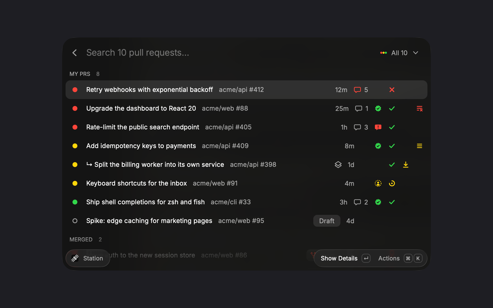
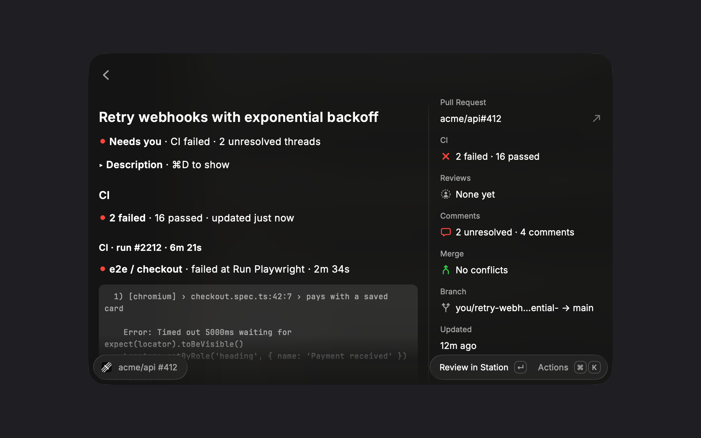

# Stoplight for Raycast

Where each of your pull requests stands, at a glance, and one key to review it in [Stoplight](https://github.com/timmywheels/stoplight).



## Reading a row

The dot on the left is the PR's own light:

- **Red, needs you**: CI failed, changes requested, conflicts, dropped from the merge queue, or unresolved review threads
- **Yellow, waiting**: CI running, review pending, in the merge queue, or behind its base
- **Green, ready**: CI passed and nothing is waiting
- **Purple check, merged**: red if the base branch is still failing after the merge

Drafts are hollow and don't go red over conflicts or pending review.

The icons on the right are always in the same order, so they line up down the list: **Comments · Review · CI · Merge · Queue**. An empty cell means there's nothing to report. Hover any of them for a summary, or press `↵` for the details page. Stacked PRs sit under the PR they're based on, marked `↳`, the way Stoplight's panel lays them out.

## The details page

`↵` on a row opens its details page, which is built for watching progress and reading feedback:

- **CI, live.** Each workflow run with its failed jobs, the step they failed at and the lines from the log that say why. Running jobs show the step they're on. While anything runs, the page refreshes every 10 seconds. It also shows the merge queue's run, the run after a merge, and whether the PR is in the queue or was dropped from it (and why).
- **Conversation.** Unresolved review threads first, with their replies, then comments and reviews, newest first. A resolved thread takes one line. Bot comments are folded away (`⌥⌘B`).
- **Description.** Folded away until you want it (`⌘D`).
- **Sidebar.** CI, reviews, comments, merge and queue as short lines with the list's icons, plus the PR link to share.



## Setup

A **Set up** row at the top of the list covers whatever's missing, and each can be dismissed:

- **Install Stoplight** (`↵`): downloads the latest release from GitHub, installs it only if it's Stoplight signed with a Developer ID and notarized, then opens it and refreshes the list once it answers. `⌘↵` opens the download page instead.
- **Start Stoplight**, when it's installed but not running.
- **Install / sign in to the GitHub CLI**: copies `brew install gh && gh auth login` (or `gh auth login`) to paste into a terminal.

What each one provides:

- **[Stoplight](https://github.com/timmywheels/stoplight)** running: the list comes from its snapshot on `127.0.0.1:47400`, so it matches the menu bar exactly and costs no extra GitHub calls.
- **[GitHub CLI](https://cli.github.com)** signed in (`gh auth login`): unresolved threads, requested reviewers and merge queue history come from one GraphQL query through `gh`, and the details page's live CI and conversation come from two more per refresh (1 point each against GitHub's rate limit). Failed job logs are read once each. Without `gh`, comments and reviews still come from Stoplight's snapshot. It's also the fallback when Stoplight isn't running.

## Shortcuts

| Key | Action |
| --- | --- |
| `↵` | Show details (in the list) / review in Stoplight (on the details page) |
| `⌘↵` | Review in Stoplight (in the list) / copy URL (on the details page) |
| `⌘D` / `⌥⌘B` | Show the description / bot comments (details page) |
| `⇧⌘J` | Open the first failed or running job (details page) |
| `⌘O` | Open on GitHub |
| `⇧⌘A` / `⇧⌘K` / `⇧⌘M` | Actions run / checks tab / merge queue |
| `⇧⌘F` | Files changed |
| `⇧⌘C` / `⇧⌘L` | Copy URL / copy title as a link |
| `⌘B` / `⇧⌘B` | Copy branch / commit hash |

## Development

```bash
npm install
npm run dev    # loads it into Raycast
npm test
```

Screenshots use made-up data: `raycast://extensions/<author>/stoplight/prs?launchContext={"demo":true}`.
